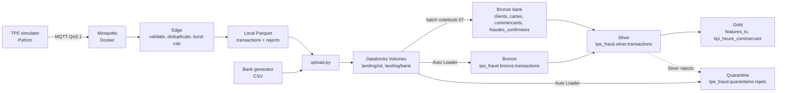

# Card Fraud Detection on a POS Terminal Network

IoT–Edge–Cloud and Big Data project · ENSA Agadir
Group: Saadia BOUSSIAR, Ouissal MAOUN, Nisrine BOULAKHBAR, Yassmine OUKHRIS

This repository contains a card-fraud detection platform for a network of simulated payment terminals (POS, called "TPE" in French): terminal simulation, Edge processing, transport to Databricks, Delta tables (Bronze, Quarantine), then Silver, Gold, KPIs and the model.

> **Progress (MVP 1)**
>
> | Task | Content | Status |
> |---|---|---|
> | Task 1 | Steps 0 to 6: generator, simulator, Mosquitto, Edge, upload, Auto Loader into Bronze and Quarantine | **Done** |
> | Task 2 | Steps 7 to 9: bank Bronze tables, Silver (`is_fraud` label), Gold (features) | **Done** (see sections 11 and 12, and `docs/TASK2.fr.md`) |
> | Task 3 | Steps 10 to 13: SQL KPIs, baseline and model, visible result, end-to-end tests | To do |

## 1. MVP 1 architecture



- **Local:** bank generator, simulator, Mosquitto (Docker), Edge, upload script.
- **Cloud (Databricks):** Volumes, Auto Loader, Delta tables, then Silver, Gold, KPIs, model.
- **Hybrid:** the Edge-to-Cloud crossing is done by dropping Parquet files into a Databricks Volume.

MVP 1 is a subset of the validated architecture. Postponed to later versions: terminal telemetry (the `tpe/<id>/status` flow), Kafka, PostgreSQL, several gateways, terminal registry, scheduled jobs, risk levels, full dashboard.

## 2. Repository structure

```
config/                  mosquitto.conf (queue limits, see section 9)
docs/proofs/             Task 1 proofs (JSON counts)
docs/TASK2.fr.md         Task 2 guide: how each notebook works, expected results, handover to Task 3
edge/
  gateway.py             Edge: validation, deduplication, burst rule, Parquet output
  upload.py              sends finished files to the Databricks Volumes
generator/
  generate_bank.py       clients, cards, merchants, card profiles, terminals
pipeline/
  sql/                   Databricks schema creation
  notebooks/             Databricks notebooks (06a, 06b: Auto Loader; 07: bank Bronze; 08: Silver; 09: Gold)
simulator/
  simulate_tpe.py        TPE simulator (MQTT publisher), injects frauds and invalid messages
  count_subscriber.py    test subscriber: messages received = messages emitted
tests/                   60 automated tests (pytest)
docker-compose.yml       Mosquitto
.env.example             variables to copy into .env (never committed)
```

The `data/` folder is created at run time and is not versioned.

## 3. Prerequisites

- Python 3.10, Docker Desktop (running), Git
- A Databricks workspace with serverless compute, a schema and Volumes (see section 4)
- A Databricks personal access token (kept out of the repository)

## 4. Installation

```powershell
git clone https://github.com/<user>/tpe-fraud-detection.git
cd tpe-fraud-detection
python -m venv .venv
.venv\Scripts\activate
pip install -r requirements.txt
copy .env.example .env        # then fill in .env
```

**`.env`** (never committed):

```
MQTT_HOST=localhost
MQTT_PORT=1883
DATABRICKS_HOST=https://<your-workspace>.cloud.databricks.com
DATABRICKS_TOKEN=<your-token>
DATABRICKS_VOLUME_IOT=/Volumes/tpe_fraud/landing/iot
DATABRICKS_VOLUME_BANK=/Volumes/tpe_fraud/landing/bank
```

**On the Databricks side** (once, in the SQL Editor):

```sql
CREATE CATALOG IF NOT EXISTS tpe_fraud;
CREATE SCHEMA  IF NOT EXISTS tpe_fraud.landing;
CREATE VOLUME  IF NOT EXISTS tpe_fraud.landing.iot;
CREATE VOLUME  IF NOT EXISTS tpe_fraud.landing.bank;
CREATE VOLUME  IF NOT EXISTS tpe_fraud.landing.checkpoints;
CREATE SCHEMA  IF NOT EXISTS tpe_fraud.bronze;
CREATE SCHEMA  IF NOT EXISTS tpe_fraud.quarantaine;
CREATE SCHEMA  IF NOT EXISTS tpe_fraud.silver;
CREATE SCHEMA  IF NOT EXISTS tpe_fraud.gold;
```

Installation check: `pytest` must show **60 passed**.

## 5. Execution guide (Task 1)

Run every command **from the project root**, with `.venv` activated.

| # | Command | Role |
|---|---|---|
| 1 | `docker compose up -d` | Starts Mosquitto |
| 2 | `python generator/generate_bank.py` | Generates the bank CSVs (`data/bank/`), card profiles and terminals (`data/`) |
| 3 | `python edge/gateway.py --idle 30` | Starts the Edge **before** the simulator (stops 30 s after the last message) |
| 4 | `python simulator/simulate_tpe.py` | Publishes transactions over MQTT, writes `fraudes_confirmees.csv`, `ground_truth.csv`, `counts.json` |
| 5 | `python edge/upload.py --dry-run`, then `python edge/upload.py` | Sends the finished files to the Volumes |
| 6 | Notebooks `06a` then `06b` in Databricks | Auto Loader into Bronze and Quarantine |

Notes:

- An MQTT message published with no subscriber is lost: the Edge (or `count_subscriber.py`) must be listening **before** the simulator starts.
- To check step 3 on its own: run `python simulator/count_subscriber.py` in one terminal, then the simulator in another.
- Real-time demo: `python simulator/simulate_tpe.py --mode realtime --days 1 --speed 600` (ids `TXR-…`, does not overwrite `fraudes_confirmees.csv`).
- Notebooks `06a` and `06b` are imported into Databricks (**Workspace**, **Import**) and run on serverless compute. The `expected_rows` widget takes the total expected from the upload report (8232 for `06a`, 124 for `06b`).

### Starting over from scratch

If the Edge is run again, the new files have different names. Clear the old state first, otherwise Bronze ends up with duplicates.

```powershell
Remove-Item -Recurse -Force data/edge_out
Remove-Item data/upload_state.json, data/sim/counts.json
```

```sql
DROP TABLE IF EXISTS tpe_fraud.bronze.transactions;
DROP TABLE IF EXISTS tpe_fraud.quarantaine.rejets;
```

Then, in the Databricks interface, delete the `bronze_transactions` and `quarantaine_rejets` folders in the `checkpoints` Volume, and the old files in `iot/transactions` and `iot/rejets`. **Never delete a checkpoint on its own:** Auto Loader would read every file again.

## 6. Data

All data is synthetic. Identifiers (`card_id`, `merchant_id`, `terminal_id`) are shared between the simulator and the bank.

| Item | Default value |
|---|---|
| Clients, cards, merchants, terminals | 150, 200, 20, 10 |
| City | Agadir (one city in MVP 1) |
| Simulated period | 35 days from 2026-01-05 (accelerated mode) |
| Fraud share | about 2% of valid transactions |
| Confirmation delay (chargeback) | 3 to 21 days |
| Random seed | 42 (same data on every run) |

**Message published by the terminal** (topic `tpe/<terminal_id>/transactions`, JSON): `transaction_id`, `terminal_id`, `merchant_id`, `timestamp` (ISO 8601 UTC, `2026-01-05T09:14:03Z`), `amount`, `currency` (MAD), `card_id`, `entry_mode`, `pin_verified`, `auth_response`, `mcc`. The `is_fraud` label is never in it.

**Added by the Edge:** `suspect`, `raison_suspect`, `gateway_id`, `edge_timestamp`.

**Values written without accents:** `entry_mode` is one of `puce`, `sans_contact`, `bande_magnetique`, `saisie_manuelle`; `auth_response` is `approuvee` or `refusee`; card status is `Active` or `Bloquee`; merchant status is `Actif`.

**Bank files** (`data/bank/`, sent to Databricks): `clients.csv`, `cartes.csv`, `commercants.csv`, `fraudes_confirmees.csv` (with `date_confirmation`, later than the transaction).

**Files that stay local** (never sent): `data/card_profiles.json` and `data/terminals.json` (simulator inputs), `data/sim/ground_truth.csv` (ground truth). They must never enter the pipeline, to avoid data leakage.

**Injected anomalies**

| Family | Types |
|---|---|
| Frauds | burst (6 to 10 transactions on one card within 2 minutes), abnormal amount (8 to 20 times the card's habit, at night) |
| Invalid messages | negative amount, missing field, duplicate, date in the future (5 years ahead) |
| Unusual legitimate | large purchases (label 0), 0.5% |

### Delta tables created

| Table | Content |
|---|---|
| `tpe_fraud.bronze.transactions` | Valid transactions from the Edge, with the Edge columns, `_source_file`, `_ingested_at`. Append only |
| `tpe_fraud.quarantaine.rejets` | Edge rejects (`niveau_rejet = 'Edge'`) and Silver rejects (`niveau_rejet = 'Silver'`, added by notebook 08) |
| `tpe_fraud.bronze.clients`, `cartes`, `commercants`, `fraudes_confirmees` | Bank CSVs as raw text, with `_source_file` and `_ingested_at` (notebook 07) |
| `tpe_fraud.silver.transactions` | Deduplicated, typed transactions enriched with card and merchant data, with the `is_fraud` label (notebook 08) |
| `tpe_fraud.gold.features_tx` | One row per transaction, features computed from the past only (notebook 09) |
| `tpe_fraud.gold.kpi_heure_commercant` | Aggregates per hour and merchant, for the KPIs (notebook 09) |

## 7. Task 1 results and proofs

The proof files are in `docs/proofs/`.

| Step | Proof | Result |
|---|---|---|
| Simulator | `counts.json` | 8397 messages emitted: 8232 valid, 124 invalid to be rejected, 41 duplicates; 165 fraudulent transactions |
| Mosquitto | `received.json` | 8397 received = 8397 emitted |
| Edge | `edge_stats.json` | received 8397 = valid 8232 + rejected 124 + duplicates 41; 33 transactions flagged suspect |
| Edge rejects | `edge_stats.json` | `date_future` 41, `montant_non_positif` 42, `champ_manquant` 41 |
| Parquet files | `edge_stats.json` | 9 transaction files (8232 rows), 1 rejects file (124 rows) |
| Upload | `upload_report.json` | 14 files sent (10 Parquet, 4 CSV), sizes checked on the Databricks side |
| Auto Loader | notebooks `06a`, `06b` | Bronze = 8232 rows, Quarantine = 124 rows, equal to the upload counts; rerun without duplicates |

## 8. Tests

```powershell
pytest
```

60 tests: generator (9), simulator (14), Edge (24), upload script with a fake Databricks client (13). The Databricks notebooks are not covered by `pytest`: they are checked by the counts in sections 7 and 12 (notebooks 07 to 09 stop on a failed assertion).

## 9. Known limits and lessons learned

- **Synthetic data:** the frauds are injected by the team, so they are easy to detect. Model scores must be read with that caveat.
- **Edge burst rule:** it flags from the 6th transaction on. The first ones in a burst have already left as normal, and abnormal amounts are not seen by the Edge (33 suspects out of 165 frauds). The baseline will therefore be limited.
- **One IoT flow in MVP 1:** transactions. Terminal telemetry and terminal-level fraud come in MVP 2.
- **Mosquitto and message loss:** with the default settings (queue of 1000 messages, 20 in flight), the Edge received only part of the stream (4265, 3924, then 5523 messages out of 8397). Two changes gave 8397: a separate thread that processes messages (the network thread is no longer blocked by file writing) and, in `config/mosquitto.conf`, `max_queued_messages 100000` and `max_inflight_messages 500`. We did not test each change in isolation: the broker queue is the most likely decisive cause. It is also the argument for Kafka (durable buffer, replay) in MVP 2.
- **Databricks environment:** serverless compute, usage quotas, Auto Loader run by hand in "read new files, then stop" mode.
- **Local machine:** Mosquitto, simulator and Edge run together; available memory must be enough.
- **Rerunning the simulator** rewrites `fraudes_confirmees.csv`: only do it after clearing Bronze, otherwise the confirmed frauds no longer match the transactions already ingested.
- **Silver rejects nothing on this data:** the synthetic bank and terminal data are consistent (0 rejects), so the Silver rules (unknown card, unknown merchant, invalid timestamp, non-positive amount) are correct by design but not exercised by the real data. A small test with an unknown card would show them working.
- **687 transactions have no label** (`label_statut = 'non_etiquete'`): they are too recent for a confirmation to be expected. This is intended, and they must be excluded from training and test.
- **The label depends on the cutoff date** (default: latest `date_confirmation`). Changing it changes which transactions are labelled.
- **Bank Bronze is a full snapshot** (overwrite), not a `MERGE` on `fraud_id`. Enough for one initial load; to revisit if confirmations arrive in several batches.

## 10. Working method

- One branch per step (`task1/setup`, `task1/generator`, `task1/simulator`, …), merged into `main`, preferably by a pull request reviewed by the next person.
- Sequential handover: Task 2 starts once the Task 1 counts are validated (section 7). Task 3 starts once the Task 2 counts are validated (section 12).
- **No secrets in Git:** `.env` is ignored; only `.env.example` (fake values) is committed. If a token is published by mistake, revoke it immediately in Databricks.
- The repository is the source of truth: any notebook change made in Databricks must be exported and committed.

## 11. Execution guide (Task 2)

Task 2 runs **entirely in Databricks** (serverless), by hand, after Task 1. Nothing to start on the PC. Full explanations, expected output of each notebook and the handover to Task 3 are in `docs/TASK2.fr.md`.

Prerequisites: Task 1 finished (Bronze 8232 rows, Quarantine 124 rows, the four bank CSVs in `/Volumes/tpe_fraud/landing/bank`) and the schemas `silver` and `gold` created (`pipeline/sql/00_setup.sql`).

Import each notebook from `pipeline/notebooks/` (**Workspace**, **Import**), attach serverless compute, click **Run all**, in this order:

| # | Notebook | Output | Expected check |
|---|---|---|---|
| 7 | `07_bronze_banque.py` | `bronze.clients`, `cartes`, `commercants`, `fraudes_confirmees` | 150, 200, 20, 165 rows |
| 8 | `08_silver_transactions.py` | `silver.transactions`, Silver rejects in `quarantaine.rejets` | Bronze 8232 = Silver 8232 + 0 rejects + 0 duplicates |
| 9 | `09_gold.py` | `gold.features_tx`, `gold.kpi_heure_commercant` | same row count as Silver, hand recomputation of the features |

Notes:

- Notebook `08` has two widgets, `date_coupure` (empty = latest `date_confirmation`) and `maturite_jours` (21). Keep the defaults.
- Notebooks 07, 08 and 09 overwrite their tables: they can be rerun safely, in order. Never touch the checkpoints of `06a` and `06b`.
- Rerunning the simulator changes `fraudes_confirmees.csv`: follow "Starting over from scratch" (section 5) first, then rerun 07, 08 and 09.

## 12. Task 2 results and proofs

| Step | Check | Result |
|---|---|---|
| Bank Bronze | row counts | clients 150, cartes 200, commercants 20, fraudes_confirmees 165 |
| Silver | Bronze = Silver + rejects + duplicates removed | 8232 = 8232 + 0 + 0 |
| Silver | frauds labelled 1 vs confirmed frauds | 165 = 165, no confirmed fraud without a transaction |
| Silver | label distribution | `fraude` 165, `legitime` 7380, `non_etiquete` 687 |
| Silver | Edge rule against the label (labelled rows) | `suspect` and fraud 33; not `suspect` and fraud 132; not `suspect` and legitimate 7380 |
| Gold | asserted by notebook 09 at each run | `features_tx` rows = Silver rows; aggregate totals = Silver totals; three features recomputed by hand on one card |